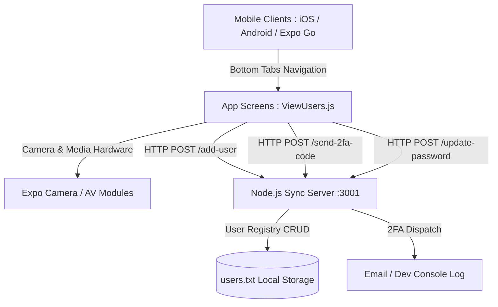

# EVO App 📱

> **A real-time cross-platform mobile collaboration and user synchronization platform built with React Native, Expo, and Node.js for UT Dallas CS1200.**

[](https://github.com/PatricioSal/EVO_App)
[](https://expo.dev)
[](https://react.dev)
[](https://nodejs.org)
[](https://cs.utdallas.edu)

---

## 📖 Overview

**EVO App** is a mobile application and synchronization microservice engineered as a collaborative team engineering project for **CS1200 at The University of Texas at Dallas**. The application provides teams with real-time user presence synchronization, member registries, multi-step 2FA security verification, and media capabilities across iOS, Android, and Web platforms.

---

## ⚡ Key Features

* **👥 Real-Time User Synchronization & Presence**:
  * Live user registry displaying active status, last activity, and connection state.
  * Multi-device state consistency managed via dedicated client-server synchronization protocols (`syncUsers.js`, `userSync.js`).

* **🔐 Built-in Authentication & 2FA Verification Flow**:
  * User onboarding and account creation with email uniqueness validation (`/add-user`).
  * Two-Factor Authentication (2FA) verification code engine (`/send-2fa-code`) with developer console logging and production SMTP/Nodemailer support.
  * Secure password update and recovery workflow (`/update-password`).

* **📱 Modern Cross-Platform Mobile UI**:
  * Built with **React Native 0.81** and **Expo SDK 54**.
  * Fluid bottom tab navigation and native stack transitions via `@react-navigation`.
  * Sleek visual styling featuring `expo-linear-gradient` and dark mode components.

* **📷 Native Hardware & Media Capabilities**:
  * Camera capture integration via `expo-camera`.
  * Audio/video media playback support via `expo-av`.

---

## 🛠️ Tech Stack

| Component | Technology | Purpose |
|---|---|---|
| **Mobile Core** | React Native `0.81.4`, React `19.1.0` | Declarative, performant mobile frontend |
| **Tooling & Platform** | Expo SDK `~54.0.13` | Universal build tooling, native APIs, and dev client |
| **Navigation** | `@react-navigation/native`, `@react-navigation/bottom-tabs` | Fluid tab switching and screen stacks |
| **Media & Hardware** | `expo-camera`, `expo-av` | Photo capture and audio/video handling |
| **Backend Server** | Node.js HTTP Server (`userSyncServer.js`) | Lightweight REST synchronization microservice |
| **Data Persistence** | Flat-file / JSON schema (`users.txt`) | Lightweight local registry storage |

---

## 🏛️ System Architecture



---

## 📂 Project Structure

```text
EVO_App/
├── App.js                   # Root navigator and screen router
├── index.js                 # Expo application entry point
├── app.json                 # Expo configuration & app manifest
├── package.json             # Dependencies and lifecycle scripts
├── HomeScreen.js            # Main home screen & community feed
├── ViewUsers.js             # Live member directory & presence monitor
├── Login.js / Signup.js     # User authentication & registration flows
├── TwoFactorAuth.js         # 2FA PIN verification & security workflow
├── ChangePassword.js        # Credential update & recovery
├── DeleteUser.js            # Account management & deletion handling
├── CameraScreen.js          # Native camera photo capture module
├── Video.js / PostPreview.js # Media preview, recording, and playback
├── Challenge.js             # Interactive challenge & activity screen
├── AdminSettings.js         # Administrative dashboard & permissions
├── SystemLogs.js            # System event and audit logging
├── UserStatistics.js        # Analytics and usage metrics
├── userSyncServer.js        # Node.js synchronization backend & 2FA microservice
├── syncUsers.js             # Client-side user synchronization handler
├── userSync.js              # Network fetch utilities and state updater
├── users.txt                # Flat-file database for persisted user records
├── assets/                  # App icons, splash screens, and branding
└── README.md                # Comprehensive project documentation
```

---

## 🔌 API Endpoints (`userSyncServer.js`)

The synchronization server runs on port `3001` (or `PORT` environment variable) and exposes the following REST endpoints:

### 1. `POST /add-user`
Registers a new user into the shared registry.
* **Request Body:**
  ```json
  {
    "email": "student@utdallas.edu",
    "password": "securePassword123"
  }
  ```
* **Response (200 OK):**
  ```json
  {
    "success": true,
    "message": "User added successfully"
  }
  ```

### 2. `POST /send-2fa-code`
Dispatches a 6-digit verification code. In development mode, the code is printed directly to the server terminal.
* **Request Body:**
  ```json
  {
    "email": "student@utdallas.edu",
    "code": "482910"
  }
  ```
* **Response (200 OK):**
  ```json
  {
    "success": true,
    "message": "Code sent (check console for development)",
    "code": "482910"
  }
  ```

### 3. `POST /update-password`
Updates existing credentials after verified 2FA.
* **Request Body:**
  ```json
  {
    "email": "student@utdallas.edu",
    "newPassword": "newSecurePassword456"
  }
  ```
* **Response (200 OK):**
  ```json
  {
    "success": true,
    "message": "Password updated successfully"
  }
  ```

---

## 🚀 Getting Started

### Prerequisites
* [Node.js](https://nodejs.org) (v18 or newer recommended).
* [Expo Go](https://expo.dev/client) app installed on your physical iOS or Android device (or an Xcode/Android Studio simulator).

### Step 1: Clone the Repository
```bash
git clone https://github.com/PatricioSal/EVO_App.git
cd EVO_App
```

### Step 2: Install Dependencies
```bash
npm install
```

### Step 3: Start the Synchronization Server
In your first terminal window, start the local backend:
```bash
npm run sync-server
```
> Server will listen on `http://localhost:3001` and output verification codes to the console.

### Step 4: Launch the Expo Mobile App
In a second terminal window, start the Expo bundler:
```bash
npm start
```
* **Scan QR Code:** Open the Expo Go app on your phone and scan the terminal QR code.
* **iOS Simulator:** Press `i` in the terminal.
* **Android Emulator:** Press `a` in the terminal.
* **Web Preview:** Press `w` in the terminal.

---

## 👥 Course & Team Context

* **Institution**: The University of Texas at Dallas
* **Course**: CS 1200 — Introduction to Computer Science & Software Engineering
* **Project Type**: Collaborative Team Software Engineering Project

---

## 👤 Author & Contributor

* **Patricio Salinas** — [GitHub (@PatricioSal)](https://github.com/PatricioSal)

---

## 📄 License

This project is licensed under the [0BSD License](LICENSE) — free and unencumbered software released into the public domain.
